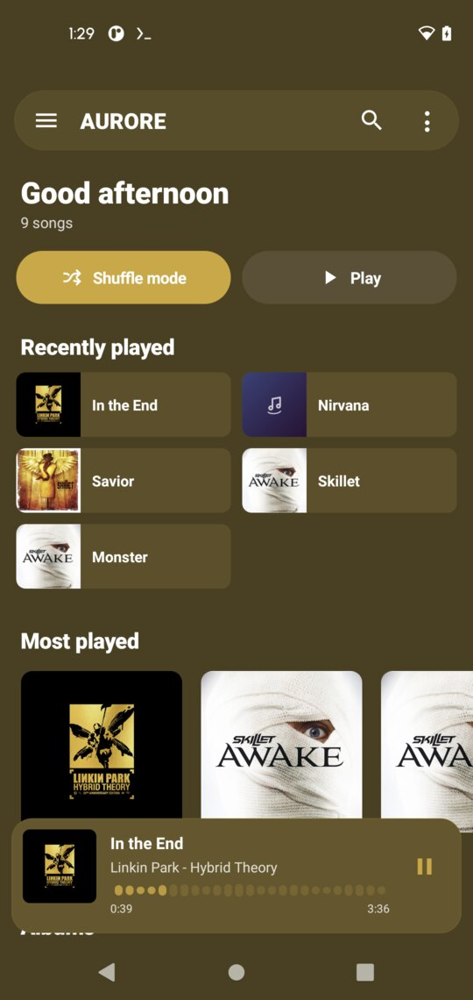
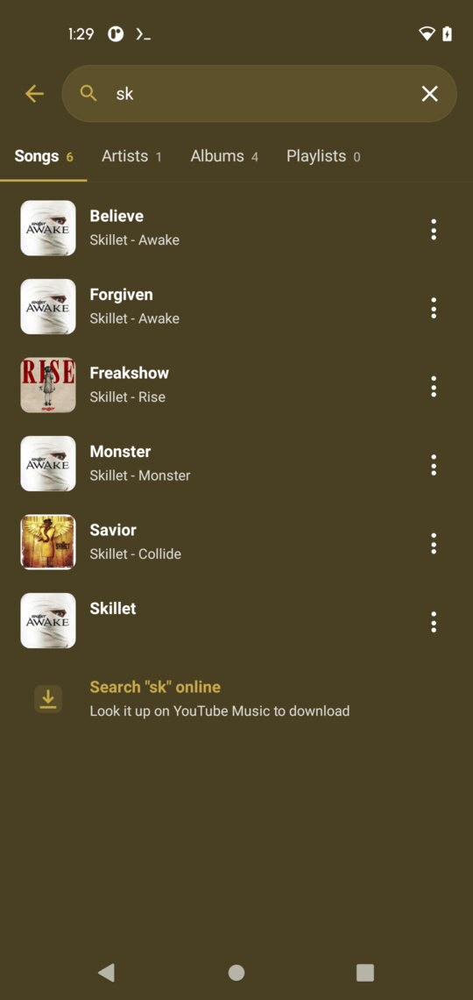
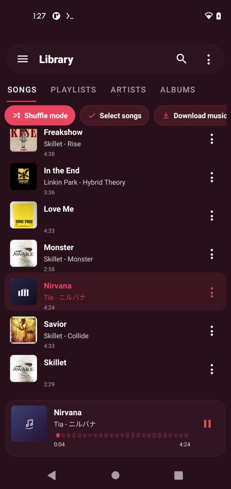
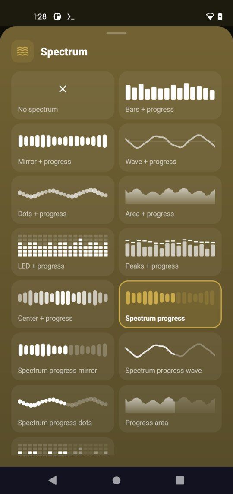
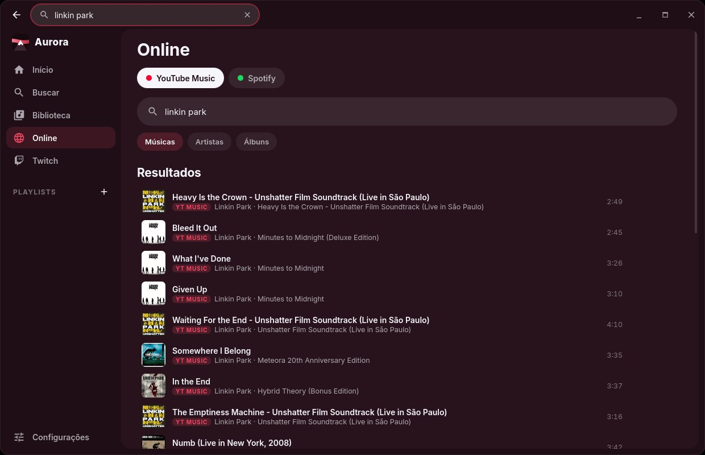

# Aurore Player

A music player for Android and PC with synced lyrics, translation and online search.

**[Download for Android](../../releases/latest)** · Android 8.0+ 
**[Download for PC](../../releases/latest)** · Linux (AppImage) and Windows

&nbsp;
&nbsp;

&nbsp;
&nbsp;

## Features

- Your library: songs, artists, albums and playlists, with a Home screen of recent and most played music
- Synced lyrics that follow the song, translated into your language
- Colors taken from the artwork, 15 visualizer styles and swipe gestures in the player
- Up next queue, sleep timer and crossfade
- Search your library, or search and download music online
- English, Portuguese, Spanish, French, Italian and Russian

## Aurore Player for PC

The same player on Linux and Windows, plus:

- Search YouTube Music by song, artist or album, and import YouTube Music playlists
- Spotify search is not working yet
- Save a playlist to a folder on your computer
- Mini player when you minimize or close the window
- Twitch song requests: chat `!sr`, channel points, mod commands and an OBS overlay
- Themes, and updates from inside the app on Linux

## Install on Android

1. Open [Releases](../../releases/latest) and download `aurore-player-X.Y.Z-arm64-v8a.apk`
   (works on most phones; use `universal` if you are not sure).
2. Open the file and allow "Install unknown apps" if Android asks.

To update, install the new version over the old one. Your music and playlists stay.

## Install on PC

Open the [latest release](../../releases/latest) and download:

- **Linux:** `aurore-player-desktop-X.Y.Z-linux-x86_64.AppImage`. Make it executable
  (`chmod +x aurore-player-desktop-*.AppImage`, or Properties → Allow executing) and open it.
- **Windows:** `aurore-player-desktop-X.Y.Z-windows-x64-portable.zip`. Extract it and open
  `aurore-player.exe` inside the `Aurore Player` folder. No installation needed (Windows 10 or 11).

On Linux the app checks for updates on start and asks before installing. On Windows, download the new zip.

## Problems or ideas

Open an [issue](../../issues/new/choose) with your phone model and Android version (or your PC system) and the app version.

---

Aurore Player is an independent project, not affiliated with Google, YouTube or any other service.
Only download content you have the right to download.
© Abyssal Foundry. All rights reserved. See [LICENSE](LICENSE).
